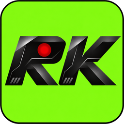

<h1 align="center">ReKapture</h1>

Free Instant Replay and recording for NVIDIA GPUs, with every setting unlocked.

ReKapture records your games with your NVIDIA GPU's built-in video encoder (NVENC), the same chip the NVIDIA App uses, so it barely touches your frame rate. It follows whatever game you're playing, puts Discord voice on its own track, and gets clips into Discord in a couple of clicks.

## Download

Get the latest version from **[Releases](../../releases/latest)**:

- **ReKapture-Setup-x.y.z.exe**: the installer (recommended). ReKapture updates itself after that.
- **ReKapture-Portable-x.y.z.zip**: no install. Unzip it anywhere you can write to, like Documents or a USB stick. It also updates itself.

Windows may say "Windows protected your PC" because ReKapture isn't code-signed. Click **More info**, then **Run anyway**.

**Needs:** Windows 10 (version 2004 or newer) or Windows 11, 64-bit, and an NVIDIA GTX 10-series or newer GPU with a current driver.

## Features

- **Instant Replay.** Keeps the last few minutes (up to 20) and saves them with one hotkey (Alt+Shift+F10). It can run all the time, or only while you're playing a game.
- **Follows your game.** Notices when a game starts (Steam, Epic, Xbox, GOG, EA, Ubisoft, Riot, or anything full screen) and records just its window, so notifications and your other monitors stay out. Clips are sorted into a folder per game.
- **Every setting unlocked.** Resolution, aspect ratio (including 9:16 vertical), 30–240 fps, H.264, HEVC or AV1, bitrate up to 300 Mbps, and every NVENC preset.
- **Smart audio.** Game audio, Discord and your mic can each go on their own track, with an everything-mixed track first so clips play right anywhere. You can also leave Discord out entirely.
- **Built-in editor.** Trim to the exact frame and change each track's volume.
- **Discord sharing.** Copy a clip sized to fit your upload limit and paste it into any chat, or post it straight to a channel.
- **Automatic updates** from this page, each one checked against its SHA-256 before it installs.
- **Safe with anti-cheat.** ReKapture never reads or injects into game processes. It uses Windows' own capture, like OBS.

## Building from source

See [BUILDING.txt](BUILDING.txt). In short: Go 1.24+, a BtbN FFmpeg master LGPL build, and NSIS for the installer. `scripts/build-release.sh` builds a complete release.

## Credits

Video encoding by [FFmpeg](https://ffmpeg.org) (LGPL v2.1+), from [BtbN/FFmpeg-Builds](https://github.com/BtbN/FFmpeg-Builds).

ReKapture is an independent project. It is not affiliated with or endorsed by NVIDIA. NVIDIA, GeForce and NVENC are trademarks of NVIDIA Corporation.
